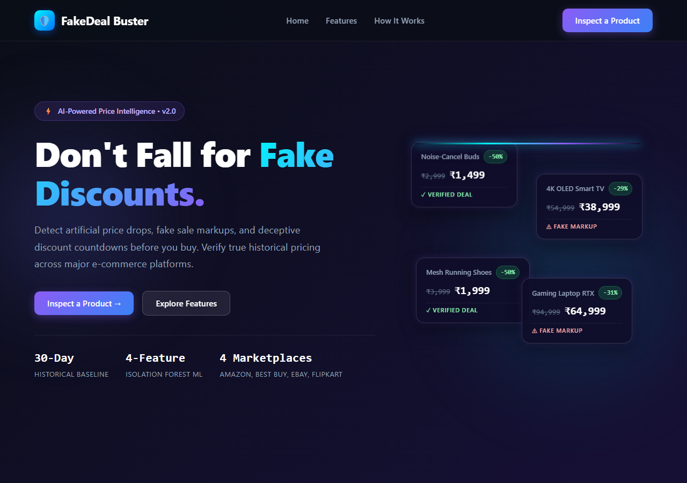
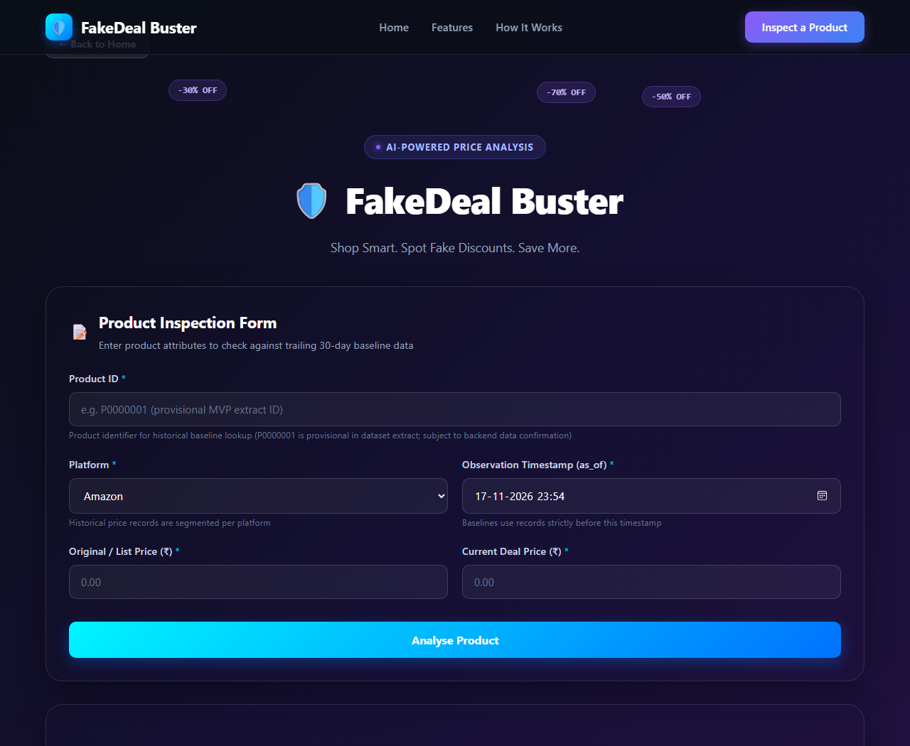

# FakeDeal Buster — Sale-Day Artificial Discount & Price Scam Detector

**FakeDeal Buster** is an academic prototype designed to detect artificial reference-price inflation, deceptive sale-day discounts, and abnormal pricing behaviors on major e-commerce platforms.

It integrates historical price pattern analysis from a multi-million observation Kaggle dataset, production Isolation Forest anomaly detection, a rigorous supervised benchmark (Logistic Regression vs. Random Forest) on 40,000 synthetic discount scenarios, conditional 14-day price forecasting with chronological backtesting, and a full-stack FastAPI + React/Vite interface.

---

## 1. Executive Implementation Summary

### Implemented Now (Working Academic Prototype)
- **Dataset-Backed Analysis:** Uses `artifacts/derived/fakedeal_runtime.duckdb` derived from 25,606,940 historical records (9,980 products, 5 marketplaces: Amazon, Best Buy, eBay, Flipkart, Walmart; 7 categories: Appliances, Books, Electronics, Fashion, Gaming, Household, Sports) spanning 2023-01-01 through 2024-12-30.
- **Production Anomaly Detection (Isolation Forest):** Preserves `isolation_forest_v1` with canonical 4-feature engineering (`msrp_to_30d_avg`, `ratio_to_30d_avg`, `price_volatility_30d`, `recent_7d_surge`), training preprocessing, and SHA256 checksum verification.
- **Standardized 3-State Assessment Verdict:**
  1. `Potential Suspicious Discount Pattern` (anomaly detected relative to 30-day baseline)
  2. `No Suspicious Pattern Detected` (normal historical pricing conformity)
  3. `Insufficient Evidence` (fewer than 14 observed days available before check date)
- **Supervised Synthetic Scenario Experiment (LR vs. RF):** 40,000 balanced, reproducible synthetic scenarios (28,000 train / 6,000 validation / 6,000 held-out test). Preprocessing fitted exclusively on train. Model and decision threshold selected on validation under FPR $\le$ 10% constraint. Final evaluation on held-out test:
  - **Random Forest (Selected):** Precision: 89.54%, Recall: 73.60%, F1: 0.8079, ROC-AUC: 0.9160, PR-AUC: 0.9308, Gini: 0.8320, FPR: 8.60% (Threshold: 0.4100).
  - **Logistic Regression (Baseline):** Precision: 87.99%, Recall: 66.70%, F1: 0.7588, ROC-AUC: 0.8891, PR-AUC: 0.9019, Gini: 0.7782, FPR: 9.10% (Threshold: 0.6800).
- **Provisional FDI (Fake Discount Indicator):** Honest methodology audit. Because source data lacks live price spike flags and pre-discount hike ratios, FDI strictly returns `INSUFFICIENT_INPUTS` with component diagnostics, rather than fabricating a score.
- **Conditional 14-Day Price Forecasting:** Requires 180 consecutive daily observations before the analysis timestamp. Evaluates flat last-observation and trailing-7-day-mean baselines across 5 chronological rolling-origin windows (70 backtest points). Selects the optimal baseline by RMSE/MAE. Returns `INSUFFICIENT_HISTORY` when data is inadequate.
- **Full Backend API Integration (FastAPI):** Comprehensive endpoints for catalogue search, metadata, product inspection, forecasting, model comparison, and health reporting.
- **Frontend Integration (React 19 + Vite):** Functional Product Inspector, Model Comparison View with side-by-side benchmark tables and confusion matrices, SVG actual price charts, forecast curves, loading states, and robust error handling.

### Future Scope (Explicitly Out of Current Scope)
- Real-time marketplace web scraping (explicitly approved as future work).
- Live seller reputation, seller registration age, and verified seller feeds.
- Verified real-world fraud labels and true marketplace detection accuracy validation.
- Deep time-series forecasting (e.g., Prophet, ARIMA, LSTM) with external macroeconomic feeds.

---

## 2. Project Architecture

```
FAKEDEAL-BUSTER/
├── artifacts/
│   ├── derived/
│   │   └── fakedeal_runtime.duckdb          # Optimized derived runtime store (9,980 products)
│   ├── ml/
│   │   ├── isolation_forest_v1/             # Production Isolation Forest bundle & checksums
│   │   └── synthetic_discount_v1/           # LR vs RF artifacts, metadata & test metrics
│   └── synthetic/
│       └── discount_scenarios_v1/           # 40k synthetic dataset (train, val, test splits)
├── backend/
│   ├── app/
│   │   ├── main.py                          # FastAPI application & route definitions
│   │   ├── exceptions.py                    # Structured domain exceptions
│   │   ├── schemas/                         # Pydantic request & response schemas
│   │   └── services/                        # Catalog, history, forecast, ML & adapter services
│   ├── tests/                               # 57 comprehensive backend tests
│   ├── API_CONTRACT.md                      # Complete API contract specification
│   └── README.md                            # Backend documentation
├── docs/                                    # Academic reports, audits, and methodology specs
├── frontend/
│   ├── src/                                 # React 19 application (App.jsx, presentation, api)
│   ├── tests/                               # 29 frontend service & validation tests
│   └── package.json                         # Vite + React setup
├── ml/                                      # Central ML feature extraction, inference, FDI
├── scripts/                                 # Training, validation, dataset generation & E2E tests
└── tests/                                   # 117 central ML unit tests
```

---

## 3. Quick Start & Execution Commands

### Prerequisites
- Python 3.12+ (conda environment `fakedeal` recommended)
- Node.js v20+ and npm

### 1. Start the Backend API
From the project root:
```powershell
$env:PYTHONPATH = "backend"
& "C:\Users\GAURAV DAS\.conda\envs\fakedeal\python.exe" -m uvicorn app.main:app --app-dir backend --host 127.0.0.1 --port 8000 --reload
```
The backend starts at `http://127.0.0.1:8000`. Interactive OpenAPI documentation is at `http://127.0.0.1:8000/docs`.

### 2. Start the Frontend
In a separate terminal:
```powershell
Set-Location frontend
npm.cmd run dev
```
Open `http://localhost:5173` in your browser.

---

## 4. Comprehensive Test Suite Execution

All test suites have been verified and pass:

```powershell
# 1. Central ML Unit Tests (117 tests)
& "C:\Users\GAURAV DAS\.conda\envs\fakedeal\python.exe" -m pytest tests/ -v

# 2. Backend API Tests (57 tests)
$env:PYTHONPATH = "backend"
& "C:\Users\GAURAV DAS\.conda\envs\fakedeal\python.exe" -m pytest backend/tests/ -v

# 3. Frontend Unit & Presentation Tests (29 tests)
Set-Location frontend
npm.cmd test

# 4. Frontend Production Build & Lint
npm.cmd run build
npm.cmd run lint

# 5. Complete End-to-End Workflow Verification
Set-Location ..
$env:PYTHONPATH = "backend"
& "C:\Users\GAURAV DAS\.conda\envs\fakedeal\python.exe" scripts/test_end_to_end.py
```

---

## 5. Demonstration Sequence for Academic Evaluation

1. **Service Health Check:**
   - Navigate to `http://127.0.0.1:8000/health`. Confirm `status: healthy`, `database: available`, and model bundles present.
2. **Dataset-Backed Analysis (Normal Historical Baseline):**
   - Open `http://localhost:5173/#inspector`.
   - In Product Name, type `Google Max Smartphones`. Select `Google Max Smartphones  (Green) · Electronics · amazon`.
   - Original Price: `239.02`, Current Price: `203.62`.
   - Check `Historical analysis` checkbox. Select `2024-10-18T00:00`.
   - Click **Analyse Product**.
   - **Review Output:**
     - Overall Assessment: `No Suspicious Pattern Detected` (normal baseline conformity).
     - Isolation Forest: `NO_ANOMALY` (score: -0.1576).
     - FDI: `INSUFFICIENT_INPUTS` (clean honest explanation of missing live signals).
     - Conditional Forecast: `AVAILABLE` with 14 projected points and 5-window rolling backtest validation.
     - Synthetic Classifier: `Resembles the generated genuine-discount scenario`.
3. **Artificial Reference-Price Inflation Scenario:**
   - Retain the same product and date (`2024-10-18T00:00`).
   - Enter Original Price: `850.00`, Current Price: `50.00` (extreme artificial markup).
   - Click **Analyse Product**.
   - **Review Output:**
     - Overall Assessment: `Potential Suspicious Discount Pattern`.
     - Isolation Forest: `ANOMALY` (unusual feature combination flagged).
     - Synthetic Classifier: `Resembles the generated artificial-inflation scenario`.
4. **Insufficient Historical Data (Past Dataset Range):**
   - Set the date to `2026-11-18T00:00` or leave historical mode unchecked (uses current time).
   - Click **Analyse Product**.
   - **Review Output:**
     - Overall Assessment: `Insufficient Evidence`.
     - Analysis Status: `NEEDS_MORE_DATA`.
     - Forecast: `INSUFFICIENT_HISTORY` (system honestly reports data insufficiency without fabricating values).
5. **Supervised Experiment Benchmark Display:**
   - Click **Model Comparison** in the top navigation bar or **View Supervised Model Benchmark** inside the Synthetic Scenario card.
   - **Review Output:**
     - Side-by-side performance table for Logistic Regression vs Random Forest.
     - Validation-selected threshold (0.4100 for Random Forest) under FPR $\le$ 10% constraint.
     - Confusion matrices for both models on 6,000 held-out test examples.
     - Academic disclaimer confirming these reflect synthetic held-out performance, not real fraud ground truth.

---

## 6. Application User Interface & Screenshots

| Landing & Overview Interface | Interactive Product Inspector & Price History |
|:---:|:---:|
|  |  |
| *Landing overview with methodology highlights and quick navigation* | *Product Inspector showing 3-state verdict, price charts, and 14-day forecasts* |

---

## 7. Cloud Deployment Guide (Free Tier Production)

FakeDeal Buster is architected for free-tier cloud deployment using **Render** (Backend API & Analytical Store) and **Vercel** (Frontend SPA):

### A. Deploy Backend API to Render (Web Service)
1. Fork or push the repository to your GitHub account (`https://github.com/gauravdas3245/FAKEDEAL-BUSTER`).
2. Log into [Render.com](https://render.com) and click **New + > Web Service**.
3. Connect your repository and select branch `main` (or `feature/complete-project-consolidation`).
4. Configure the service settings:
   - **Environment:** `Python 3`
   - **Build Command:** `pip install -r requirements.txt`
   - **Start Command:** `uvicorn app.main:app --host 0.0.0.0 --port $PORT --app-dir backend`
   - **Plan:** Free
5. Add Environment Variables:
   - `PYTHONPATH`: `backend`
   - `FAKEDEAL_DATABASE_PATH`: `artifacts/derived/fakedeal_demo.duckdb`
   - `CORS_ALLOWED_ORIGINS`: `http://localhost:5173,https://*.vercel.app`
6. Click **Create Web Service**. Note your public URL (e.g., `https://fakedeal-buster-api.onrender.com`).
7. Confirm deployment by visiting `https://<your-render-url>/health` (should return `{"status": "healthy"}`).

### B. Deploy Frontend to Vercel
1. Log into [Vercel.com](https://vercel.com) and click **Add New... > Project**.
2. Import your GitHub repository.
3. Configure the project settings:
   - **Framework Preset:** `Vite`
   - **Root Directory:** `frontend`
   - **Build Command:** `npm run build`
   - **Output Directory:** `dist`
4. Add Environment Variable:
   - `VITE_API_BASE_URL`: `https://<your-render-url>` (your deployed Render API URL, without trailing slash)
5. Click **Deploy**. Vercel automatically deploys the frontend with SPA rewrites via `vercel.json`.

---

## 8. Academic Team, Student IDs & Attribution

Developed for the Final Capstone Project at **Scholar Institute of Technology and Management (SITM), Guwahati**.

- **Institution:** Scholar Institute of Technology and Management (SITM), Guwahati
- **Department:** Department of Computer Science & Engineering
- **Programme:** Bachelor of Computer Applications (BCA)
- **Group:** Group B
- **Faculty Mentor:** Prof. Nitish Kumar Sarma

| Team Member | Student ID | Academic Project Role | Primary Focus Area |
|---|---|---|---|
| **Gaurav Das** | 2681000390 | Team Leader & ML Lead | Project architecture, Isolation Forest, LR vs RF benchmark, GitHub maintainer |
| **Rahul Amin** | 2681012412 | Backend & API Engineer | FastAPI services, DuckDB query engine, CORS, database fallback |
| **Lakhyajyoti Phukon** | 2681000002 | Data Preprocessing Analyst | 25.6M census audit, 59-column schema, 10 QA synthetic scenarios |
| **Saniya Begum** | 2681000003 | Frontend UI/UX Developer | React 19 SPA, Product Inspector, SVG price charts, model comparison view |
| **Myusha Chakma** | 2681000383 | Testing & QA Coordinator | End-to-end integration testing, QA protocol validation, cross-browser audits |

> *Note:* Identification numbers above are official Student IDs. University Roll Number fields are retained in blank unassigned format per SITM institutional examination regulations.
