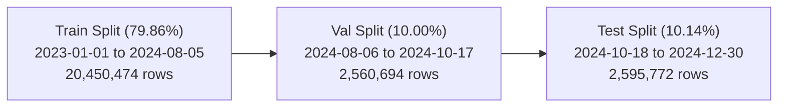

# Day 1: Dataset Schema & Target-Label Audit Report

**Project:** FakeDeal Buster — Sale-Day Artificial Discount & Price Scam Detector  
**Stage:** Day 1 Dataset Handover & Schema Audit  
**Date:** 16 November 2026 (Completed 17 November 2026 early hours)  
**Author:** Gaurav Das (Team Leader & ML Developer)  
**Assigned Data Preparation Analyst:** Lakhyajyoti Phukan  
**Data Engine Used:** DuckDB 2.0.0 (Memory-Safe Streaming / Zero Full-RAM CSV Loads)

---

## 1. Primary Dataset vs. Derived Subsets

The dataset root (`C:\end sem project\archive (5)`) contains several files organized by the original author (Amith Nair). A critical finding of the Day 1 audit is the distinction between **primary temporal splits** and **derived subsets**:

### A. Primary Temporal Splits (Authoritative Data Source)
Located in `data/splits/`, these three files represent the complete, chronologically non-overlapping partitions of the 25,606,940 price observations spanning January 1, 2023 to December 30, 2024:
1. `data/splits/ecommerce_train.csv` (20,450,474 rows | 6.16 GB / 6,609,097,454 bytes)
2. `data/splits/ecommerce_val.csv` (2,560,694 rows | 787.64 MB / 825,896,977 bytes)
3. `data/splits/ecommerce_test.csv` (2,595,772 rows | 793.44 MB / 831,979,063 bytes)

All feature engineering, baseline scoring, and testing must use these splits strictly preserving their temporal separation.

### B. Derived Subsets & Auxiliary Files (Non-Representative)
1. `data/full/ecommerce_full.csv.gz`: A compressed concatenation of all three splits. (Not loaded into memory).
2. `data/subsets/ecommerce_anomalies.csv.gz`: Contains exactly **48,554 rows**. The Day 1 census confirmed that $28,542\text{ (train)} + 806\text{ (val)} + 19,206\text{ (test)} = 48,554$. This proves this file is merely an extracted subset of all records where `price_spike_flag == 1`. It is **not** a representative pricing dataset.
3. `data/subsets/ecommerce_forecast.csv.gz`: A pre-filtered subset designated by the author for time-series forecasting.
4. `data/subsets/ecommerce_recommendation.csv.gz`: A pre-filtered subset for recommendation models.

---

## 2. Exhaustive Schema & Data Types (All 46 Columns)

The schema was extracted using DuckDB `DESCRIBE` on the uncompressed primary split without loading into Pandas. All 46 columns, their DuckDB types, and functional roles are documented below:

| # | Column Name | DuckDB Inferred Type | Python / ML Type | Functional Role |
|---|---|---|---|---|
| 1 | `product_id` | VARCHAR | String | Unique product catalog identifier |
| 2 | `title` | VARCHAR | String | Product listing display title |
| 3 | `brand` | VARCHAR | String | Product manufacturer/brand name |
| 4 | `category` | VARCHAR | String | High-level product category (7 categories) |
| 5 | `subcategory` | VARCHAR | String | Specific product subcategory |
| 6 | `platform` | VARCHAR | String | E-commerce platform (5 platforms) |
| 7 | `timestamp` | TIMESTAMP | Datetime | Observation timestamp (daily) |
| 8 | `year` | DOUBLE | Integer | Year of observation (2023 or 2024) |
| 9 | `month` | DOUBLE | Integer | Month of observation (1–12) |
| 10 | `day` | DOUBLE | Integer | Day of month (1–31) |
| 11 | `dayofweek` | DOUBLE | Integer | Day of week (0=Monday to 6=Sunday) |
| 12 | `price` | DOUBLE | Float | Current selling price (USD) |
| 13 | `original_price` | DOUBLE | Float | Advertised reference/original price (USD) |
| 14 | `discount_pct` | DOUBLE | Float | Claimed discount percentage (%) |
| 15 | `stock_status` | VARCHAR | String | Inventory availability flag |
| 16 | `avg_rating` | DOUBLE | Float | Product review rating (1.0–5.0) |
| 17 | `review_count` | DOUBLE | Float / Int | Cumulative number of user reviews |
| 18 | `is_flagship` | DOUBLE | Boolean / Int | Flag for flagship/premium product tier |
| 19 | `launch_year` | DOUBLE | Integer | Product market release year |
| 20 | `asin` | VARCHAR | String | Platform-specific Amazon identifier |
| 21 | `price_change_abs` | DOUBLE | Float | Daily price change: $P_t - P_{t-1}$ |
| 22 | `price_change_pct` | DOUBLE | Float | Daily price percentage change |
| 23 | `price_7d_avg` | DOUBLE | Float | 7-day trailing rolling average price |
| 24 | `price_30d_avg` | DOUBLE | Float | 30-day trailing rolling average price |
| 25 | `price_7d_std` | DOUBLE | Float | 7-day trailing price standard deviation |
| 26 | `price_30d_std` | DOUBLE | Float | 30-day trailing price standard deviation |
| 27 | `price_7d_min` | DOUBLE | Float | 7-day trailing minimum price |
| 28 | `price_30d_min` | DOUBLE | Float | 30-day trailing minimum price |
| 29 | `price_7d_max` | DOUBLE | Float | 7-day trailing maximum price |
| 30 | `price_30d_max` | DOUBLE | Float | 30-day trailing maximum price |
| 31 | `price_52w_min` | DOUBLE | Float | 52-week trailing minimum price |
| 32 | `price_52w_max` | DOUBLE | Float | 52-week trailing maximum price |
| 33 | `price_volatility_30d` | DOUBLE | Float | 30-day rolling price volatility |
| 34 | `discount_vs_30d_avg` | DOUBLE | Float | Discount relative to 30-day average price |
| 35 | `is_all_time_low` | DOUBLE | Boolean / Int | Binary indicator if price is historical low |
| 36 | `is_all_time_high` | DOUBLE | Boolean / Int | Binary indicator if price is historical high |
| 37 | `popularity_score` | DOUBLE | Float | Synthetic engagement index |
| 38 | `fake_discount_flag` | DOUBLE | Binary | Target indicator (Zero positive labels) |
| 39 | `price_spike_flag` | DOUBLE | Binary | Anomaly indicator (Price surge) |
| 40 | `is_black_friday_week` | DOUBLE | Boolean / Int | Calendar indicator (Nov 25–29) |
| 41 | `is_holiday_season` | DOUBLE | Boolean / Int | Calendar indicator (December sales) |
| 42 | `is_weekend` | DOUBLE | Boolean / Int | Calendar indicator (Saturday/Sunday) |
| 43 | `value_score` | DOUBLE | Float | Synthetic price-to-feature value ratio |
| 44 | `target_price_7d` | DOUBLE | Float | Future target price 7 days ahead (Leakage) |
| 45 | `target_price_30d` | DOUBLE | Float | Future target price 30 days ahead (Leakage) |
| 46 | `target_price_direction_7d` | DOUBLE | Float / Int | Future direction 7 days ahead (Leakage) |

---

## 3. Platform, Category & Temporal Boundaries

- **Platforms (5):** `amazon`, `ebay`, `walmart`, `flipkart`, `bestbuy`
- **Product Categories (7):** `Books`, `Gaming`, `Electronics`, `Fashion`, `Appliances`, `Household`, `Sports`
- **Catalog Size:** Exactly 9,980 unique product IDs continuously tracked across all splits.
- **Date Coverage:** 2023-01-01 00:00:00 to 2024-12-30 00:00:00 (730 days of daily observations).

### Split Boundaries (Strictly Chronological):

---

## 4. Missing-Value Census Observations

The entire 25.6M row dataset was queried for `NULL` values in each column:

1. **Train Split (20,450,474 rows):**
   - 5 columns exhibit exactly **35,078 null values (0.1715%)**: `price_change_abs`, `price_change_pct`, `price_7d_std`, `price_30d_std`, and `price_volatility_30d`.
   - *Observation Scope & Cause:* These nulls occur strictly during the initial days of January 2023, where trailing rolling windows (7-day and 30-day) lack sufficient prior observations to compute standard deviations or differences.
   - All other 41 columns: **0 nulls (100% complete)**.
2. **Validation Split (2,560,694 rows):**
   - **0 nulls across all 46 columns (100% complete)**. The rolling windows carry full continuity from the preceding train window.
3. **Test Split (2,595,772 rows):**
   - `target_price_7d`: **245,546 nulls (9.4595%)**.
   - `target_price_30d`: **1,052,340 nulls (40.5405%)**.
   - *Observation Scope & Cause:* Future-target lookaheads cannot be computed for records within 7 and 30 days of the dataset's terminal date (December 30, 2024).
   - All other 44 columns: **0 nulls (100% complete)**.

---

## 5. Target-Label Generation Audit

### A. Empirical Census Results
- **Full Dataset Rows:** 25,606,940
- **`fake_discount_flag == 1` (Positive):** **0 (0.0000%)**
- **`fake_discount_flag == 0` (Negative):** 25,606,940 (100.0000%)
- **`fake_discount_flag` Null Count:** 0
- **`price_spike_flag == 1` (Positive):** 48,554 (0.1896%)
- **`price_spike_flag == 0` (Negative):** 25,558,386 (99.8104%)
- **`price_spike_flag` Null Count:** 0

### B. Verification of Label-Generation Logic
An audit of all files in the source distribution (`archive (5)/metadata/metadata.json`, `archive (5)/README.md`, `archive (5)/notebook/demo.ipynb`, and root repository documentation) reveals:
- The data generation code ("ML Data Platform v1.0.0") is **not provided**.
- The mathematical condition, rule, or heuristic formula intended to set `fake_discount_flag = 1` is completely undocumented.
- In `metadata.json`, `fake_discount_flag` is merely listed under the `"anomaly"` feature group without any definition.
- **Explicit Finding:** The actual label-generation logic for `fake_discount_flag` **cannot be verified from the available source**. We will not invent or guess its intended formula.

### C. Why `price_spike_flag` Cannot Substitute for `fake_discount_flag`
It is tempting to substitute `price_spike_flag` as a surrogate binary target because it contains 48,554 positive labels. However, this is fundamentally invalid for two reasons:

1. **Diametrically Opposed Market Semantics:**
   - A **price spike** is an acute, short-term increase in the actual selling price ($P_t \gg P_{t-1}$). The dataset author explicitly documents that price spikes model supply constraints (*"Stock influence: Availability affects short-term price spikes"*).
   - A **fake discount** is an artificial markup of the advertised reference price ($\text{OriginalPrice}_t \gg \text{MedianPrice}$) designed to deceive buyers with an exaggerated discount percentage while the selling price remains unchanged or actually increases.
2. **Severe Target Distortion & False Positives:**
   - Training a classifier on `price_spike_flag` would train the model to flag stock shortages and surge pricing rather than artificial discounts.
   - It would yield severe false positives on legitimate supply crunches and completely miss classic fake discounts where the current price remains steady under an inflated MSRP.

---

## 6. Status of Lakhya's Handover & Missing Information

The initial documents prepared under `dataset/` ([dataset/data-dictionary.md](file:///C:/end%20sem%20project/FAKEDEAL-BUSTER/dataset/data-dictionary.md), [dataset/preprocessing-notes.md](file:///C:/end%20sem%20project/FAKEDEAL-BUSTER/dataset/preprocessing-notes.md)) were preliminary planning notes that contained "Pending" placeholders and conceptual descriptions.

### What Lakhya's Initial Handover Was Missing:
1. **Verification of the 46 Exact Column Names & Types:** The initial data dictionary listed broad conceptual groupings rather than the exact DuckDB schema.
2. **Empirical Distribution of `fake_discount_flag`:** Lakhya's notes listed `fake_discount_flag` as a candidate classification target without recording that it contained zero positive labels.
3. **Identification of Derived Anomaly Subset:** Lakhya's notes did not identify that `ecommerce_anomalies.csv` was an extracted subset rather than a primary dataset.
4. **Concrete Null Count Allocations:** Missing values were described conceptually rather than mapped to specific rolling features in Train and target lookaheads in Test.

### Handover Resolution:
The Stage 1 data loader and inspection scripts have resolved all these gaps empirically. Lakhyajyoti Phukan can now adopt these verified metrics to finalize `dataset/data-dictionary.md` and prepare category-level encoding recommendations for Day 2.
