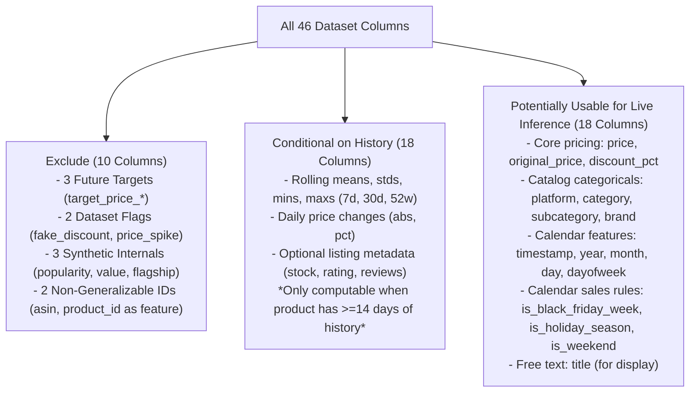

# Day 1: Target Leakage & Feature Usability Assessment

**Project:** FakeDeal Buster — Sale-Day Artificial Discount & Price Scam Detector  
**Stage:** Day 1 Data Audit & Feature Governance  
**Date:** 16 November 2026 (Completed 17 November 2026 early hours)  
**Author:** Gaurav Das (Team Leader & ML Developer)  
**Reviewers:** Rahul Amin (Backend Developer), Lakhyajyoti Phukan (Data Preparation Analyst)

---

## 1. Governance Objectives & Risk Assessment

When building a machine learning model to evaluate whether an advertised e-commerce discount is potentially misleading, two fatal data errors must be avoided:
1. **Target / Future Leakage:** Using features that incorporate future information (e.g. prices observed after the evaluation date) or directly encode the ground-truth target.
2. **Operational Unavailability (Inference Mismatch):** Training a model on complex historical aggregates or synthetic platform-internal variables that are impossible to obtain when an actual user enters a product URL or manual price into the web application.

---

## 2. Comprehensive Leakage & Usability Audit (All 46 Columns)

Each column present in the approved E-Commerce Product Price Tracker Dataset has been evaluated across four dimensions:
- **Leakage Risk:** Future data or target circularity.
- **Inference Availability:** Can a live user or catalog lookup supply this feature at runtime?
- **Decision:** `Exclude`, `Conditional`, or `Potentially Usable`.
- **Evidence / Rationale:** Supporting technical documentation from `archive (5)/metadata/metadata.json` and `archive (5)/README.md`.

| # | Column Name | Risk Category | Operational Availability | Decision | Technical Rationale & Supporting Evidence |
|---|---|---|---|---|---|
| 1 | `product_id` | Identifier | Catalog Lookup Only | **Exclude / Key Only** | High-cardinality identifier (9,980 products). Causes overfitting if used directly in numerical models. Only usable as a database lookup key to fetch historical prices. |
| 2 | `title` | Free Text | User Provided | **Potentially Usable (Metadata)** | Product title string. Available at runtime for UI display and keyword matching. Exclude from tabular numerical feature vectors. |
| 3 | `brand` | Categorical | User Provided | **Potentially Usable** | Brand name. User-selectable or extracted from title. Usable with categorical frequency encoding. |
| 4 | `category` | Categorical | User Provided | **Potentially Usable** | 7 high-level categories. User-selectable in frontend dropdown. Safe and directly available. |
| 5 | `subcategory` | Categorical | User Provided | **Potentially Usable** | Granular subcategory. User-selectable or parsed. Safe for categorical encoding. |
| 6 | `platform` | Categorical | User Provided | **Potentially Usable** | E-commerce store (5 platforms). User-selectable in frontend. Known platform pricing biases are documented in README (e.g. Flipkart 0.89 factor). |
| 7 | `timestamp` | Temporal | System Generated | **Potentially Usable** | Current date and time of user submission. Basis for calendar feature generation. |
| 8 | `year` | Temporal | System Generated | **Potentially Usable** | Extracted from submission timestamp. |
| 9 | `month` | Temporal | System Generated | **Potentially Usable** | Extracted from submission timestamp. Captures annual promotional cycles. |
| 10 | `day` | Temporal | System Generated | **Potentially Usable** | Day of month (1–31). Extracted from submission timestamp. |
| 11 | `dayofweek` | Temporal | System Generated | **Potentially Usable** | Day of week (0–6). Extracted from submission timestamp. |
| 12 | `price` | Core Feature | User Provided | **Potentially Usable** | Current advertised selling price. Primary user input; safe for analysis. |
| 13 | `original_price` | Core Feature | User Provided | **Potentially Usable** | Advertised reference/MSRP price. Primary user input; safe for analysis. |
| 14 | `discount_pct` | Core Feature | Deterministic | **Potentially Usable** | Explicitly computed: $\frac{\text{original\_price} - \text{price}}{\text{original\_price}} \times 100$. Verified safe. |
| 15 | `stock_status` | Operational | Unknown / User | **Conditional** | Inventory status (`In Stock`, `Out of Stock`). May not be reliably provided by a retail user. |
| 16 | `avg_rating` | Engagement | Optional User Input | **Conditional** | Product rating (1.0–5.0). Optional field; must handle missing defaults if user omits. |
| 17 | `review_count` | Engagement | Optional User Input | **Conditional** | Total review count. Optional field; must handle missing defaults if user omits. |
| 18 | `is_flagship` | Catalog Flag | Unavailable from User | **Exclude** | Synthetic catalog flag. Real users do not know or input whether a listing is an official flagship. |
| 19 | `launch_year` | Catalog Flag | Unavailable from User | **Exclude** | Product market launch year. Unreliable for casual user submission. |
| 20 | `asin` | Identifier | Platform Specific | **Exclude** | Amazon Standard Identification Number. Identifier only; non-generalizable across platforms. |
| 21 | `price_change_abs` | Trailing History | Historical Lookup | **Conditional** | Daily price difference ($P_t - P_{t-1}$). Requires at least 1 day of prior price history for this product. |
| 22 | `price_change_pct` | Trailing History | Historical Lookup | **Conditional** | Daily percentage price change. Requires prior day historical price. |
| 23 | `price_7d_avg` | Trailing History | Historical Lookup | **Conditional** | 7-day rolling mean price. Requires $\ge 7$ daily historical records. Cannot be computed for cold-start products. |
| 24 | `price_30d_avg` | Trailing History | Historical Lookup | **Conditional** | 30-day rolling mean price. Requires $\ge 30$ daily historical records. |
| 25 | `price_7d_std` | Trailing History | Historical Lookup | **Conditional** | 7-day rolling standard deviation. Requires historical series. |
| 26 | `price_30d_std` | Trailing History | Historical Lookup | **Conditional** | 30-day rolling standard deviation. Requires historical series. |
| 27 | `price_7d_min` | Trailing History | Historical Lookup | **Conditional** | 7-day rolling minimum price. Requires historical series. |
| 28 | `price_30d_min` | Trailing History | Historical Lookup | **Conditional** | 30-day rolling minimum price. Critical benchmark for artificial markup detection. |
| 29 | `price_7d_max` | Trailing History | Historical Lookup | **Conditional** | 7-day rolling maximum price. Requires historical series. |
| 30 | `price_30d_max` | Trailing History | Historical Lookup | **Conditional** | 30-day rolling maximum price. Requires historical series. |
| 31 | `price_52w_min` | Trailing History | Historical Lookup | **Conditional** | 52-week trailing minimum. Requires 1 full year of continuous tracking. |
| 32 | `price_52w_max` | Trailing History | Historical Lookup | **Conditional** | 52-week trailing maximum. Requires 1 full year of continuous tracking. |
| 33 | `price_volatility_30d` | Trailing History | Historical Lookup | **Conditional** | 30-day normalized price volatility. Requires 30 days of prior history. |
| 34 | `discount_vs_30d_avg` | Trailing History | Historical Lookup | **Conditional** | Discount claimed relative to 30-day average. Critical heuristic feature, but conditional on historical data. |
| 35 | `is_all_time_low` | Trailing History | Historical Lookup | **Conditional** | Cumulative minimum check. Requires full historical catalog tracking. |
| 36 | `is_all_time_high` | Trailing History | Historical Lookup | **Conditional** | Cumulative maximum check. Requires full historical catalog tracking. |
| 37 | `popularity_score` | Synthetic Metric | Unavailable from User | **Exclude** | Proprietary synthetic score in Amith Nair's dataset. Uncomputable from live web inputs. |
| 38 | `fake_discount_flag` | Target Column | Ground Truth Label | **Exclude** | Candidate target label. Contains zero positive variance across full dataset (0 positive labels). Must never be an input feature. |
| 39 | `price_spike_flag` | Target Column | Anomaly Label | **Exclude** | Distinct anomaly label representing supply-side price spikes. Excluded from input features to avoid target confusion. |
| 40 | `is_black_friday_week` | Seasonality | System Generated | **Potentially Usable** | Calendar rule: evaluates whether submission timestamp falls within November 25–29. Fully deterministic and inference-safe. |
| 41 | `is_holiday_season` | Seasonality | System Generated | **Potentially Usable** | Calendar rule: evaluates whether submission timestamp falls within December holiday window. Fully deterministic and inference-safe. |
| 42 | `is_weekend` | Seasonality | System Generated | **Potentially Usable** | Evaluates whether `dayofweek >= 5`. Inference-safe. |
| 43 | `value_score` | Synthetic Metric | Unavailable from User | **Exclude** | Undocumented internal synthetic metric from dataset author. Cannot be replicated at inference time. |
| 44 | `target_price_7d` | **Severe Leakage** | Future Information | **STRICTLY EXCLUDE** | Future price 7 days after the observation date. Using this column during model inference or training introduces catastrophic lookahead leakage. |
| 45 | `target_price_30d` | **Severe Leakage** | Future Information | **STRICTLY EXCLUDE** | Future price 30 days after the observation date. Severe lookahead leakage. |
| 46 | `target_price_direction_7d` | **Severe Leakage** | Future Information | **STRICTLY EXCLUDE** | Future price trajectory 7 days ahead. Severe lookahead leakage. |

---

## 3. Summary of Decision Categories

### Critical Operational Rule for Backend & Model:
When a user submits a product:
1. If **no historical price history** is provided, the backend must use only the `Potentially Usable` core fields (prices, category, platform, calendar rules) and output the standardized verdict: `Needs More Data` (or a cold-start heuristic with appropriate confidence capping).
2. Trailing rolling features (`price_30d_avg`, `price_30d_min`, etc.) must **never** be assumed to exist unless explicitly passed via the `historical_prices` array or queried from the historical dataset cache.
