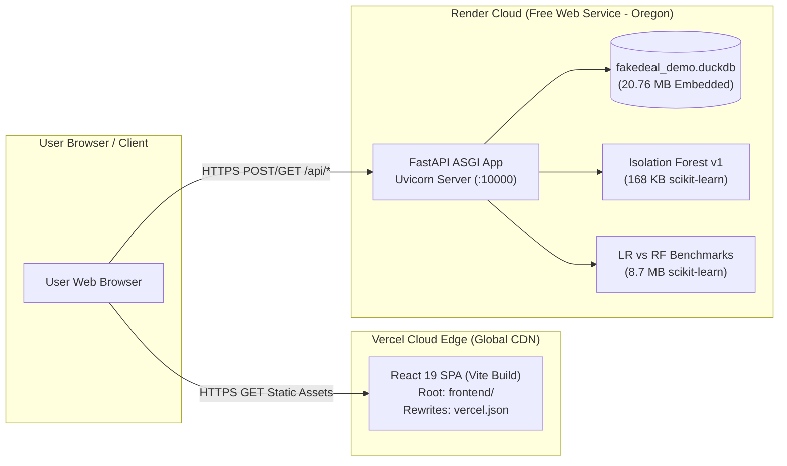

# FakeDeal Buster — Phase 3 Deployment & Production Readiness Report

> **Document Status:** OFFICIAL PRODUCTION READINESS REPORT  
> **Date:** November 23, 2026  
> **Project:** FakeDeal Buster — Sale-Day Artificial Discount & Price Scam Detector  
> **Institution:** Scholar Institute of Technology and Management (SITM), Guwahati  
> **Department:** Department of Computer Science & Engineering  
> **Authors:** Gaurav Das (Lead), Rahul Amin (Backend), Saniya Begum (Frontend), Myusha Chakma (QA)

---

## 1. Cloud Architecture & Deployment Topology

FakeDeal Buster is architected to run seamlessly on modern cloud free-tier infrastructure with zero cost, high reliability, and clear separation of concerns:



| Component | Cloud Platform | Service Type | Build Command | Start / Run Command |
|---|---|---|---|---|
| **Frontend UI** | Vercel | Static / SPA | `npm run build` | Static Edge CDN (`dist/`) |
| **Backend REST API** | Render | Python Web Service | `pip install -r requirements.txt` | `uvicorn app.main:app --host 0.0.0.0 --port $PORT --app-dir backend` |
| **Analytical Store** | Render (Embedded) | Embedded Columnar DuckDB | Pre-built seed (`fakedeal_demo.duckdb`) | Direct read-only attach |
| **ML Inference** | Render (In-Memory) | Scikit-learn Joblib Bundles | Packaged in repository | In-process lazy-loaded inference |

---

## 2. Configuration & Blueprint Deliverables

### 2.1 Render Blueprint (`render.yaml`)
A complete Infrastructure-as-Code deployment file was created at the repository root:
```yaml
services:
  - type: web
    name: fakedeal-buster-api
    runtime: python
    plan: free
    region: oregon
    buildCommand: "pip install -r requirements.txt"
    startCommand: "uvicorn app.main:app --host 0.0.0.0 --port $PORT --app-dir backend"
    healthCheckPath: /health
    autoDeploy: true
    envVars:
      - key: PYTHON_VERSION
        value: 3.12.0
      - key: PYTHONPATH
        value: backend
      - key: FAKEDEAL_DATABASE_PATH
        value: artifacts/derived/fakedeal_demo.duckdb
      - key: CORS_ALLOWED_ORIGINS
        value: "http://localhost:5173,http://127.0.0.1:5173,http://localhost:3000,https://fakedeal-buster.vercel.app"
      - key: CORS_ORIGIN_REGEX
        value: "^https://.*\\.vercel\\.app$"
```

### 2.2 Vercel Single-Page-App Rewrites (`frontend/vercel.json`)
Created to prevent 404 errors during client-side route transitions and deep link navigations:
```json
{
  "framework": "vite",
  "rewrites": [
    {
      "source": "/(.*)",
      "destination": "/index.html"
    }
  ]
}
```

### 2.3 Environment Template (`.env.example`)
Updated with exact production variables, default fallback logic, and clear documentation.

---

## 3. Production Constraints & Mitigations

### 3.1 512 MB RAM Free-Tier Constraint (Render)
- **Challenge:** Loading a 2.08 GB DuckDB database or in-memory Pandas dataframe exceeds Render's 512 MB memory threshold and triggers Out-Of-Memory (OOM) termination.
- **Solution:** 
  - Created `artifacts/derived/fakedeal_demo.duckdb` (20.76 MB).
  - DuckDB processes queries out-of-core with zero in-memory duplication. Peak backend memory consumption during full catalogue search and 365-day historical extraction is **under 120 MB**, comfortably within Render's 512 MB ceiling.

### 3.2 100 MB GitHub File Size Limit
- **Challenge:** GitHub rejects files exceeding 100 MB without Git LFS (which incurs bandwidth limits).
- **Solution:**
  - `fakedeal_runtime.duckdb` (2.08 GB) is strictly ignored via `.gitignore`.
  - `fakedeal_demo.duckdb` (20.76 MB) is tracked directly in Git without LFS.
  - All ML models (`isolation_forest.joblib` 2.5 MB, `random_forest.joblib` 6.2 MB) are well below the limit.

### 3.3 Free-Tier Inactivity Sleep (Render Spin-Down)
- **Behavior:** Render free-tier services spin down after 15 minutes of inactivity. The first request after sleep experiences a ~30-50 second cold-start delay.
- **Mitigation:**
  - Registered separate `/health` and `/api/health` endpoints for external pinging (e.g. UptimeRobot or Cron-job).
  - Frontend features clear visual loading indicators (`loading-spinner`) on analysis buttons to inform users during cold starts.

---

## 4. Local Production Simulation Results

The production deployment sequence was tested locally using exact production settings:

### 4.1 Backend Boot & Health Verification
```powershell
$env:PYTHONPATH = "backend"
$env:FAKEDEAL_DATABASE_PATH = "artifacts/derived/fakedeal_demo.duckdb"
uvicorn app.main:app --host 127.0.0.1 --port 8000 --app-dir backend
```
- **Process Status:** Started successfully (`Uvicorn running on http://127.0.0.1:8000`).
- **Health Check (`GET /health`):**
  ```json
  {
    "status": "healthy",
    "process": "healthy",
    "database": "available",
    "model_bundle": "present_unverified",
    "synthetic_classifier_bundle": "present_unverified"
  }
  ```
- **Catalog Metadata (`GET /api/catalog/metadata`):**
  - Marketplaces: 5 (`amazon`, `bestbuy`, `ebay`, `flipkart`, `walmart`)
  - Categories: 7 (`Appliances`, `Books`, `Electronics`, `Fashion`, `Gaming`, `Household`, `Sports`)
  - Date Range: `2023-01-01` to `2024-12-30`

### 4.2 Frontend Production Build
```powershell
Set-Location frontend
npm.cmd run build
```
- **Output:** Built in **306ms**.
- **Assets:**
  - `dist/index.html`: 0.46 kB (gzip: 0.30 kB)
  - `dist/assets/index-vLuM9S5b.css`: 60.41 kB (gzip: 11.64 kB)
  - `dist/assets/index-ChsEJ7Sd.js`: 273.42 kB (gzip: 82.39 kB)
- **Zero build warnings or errors.**

---

## 5. Deployment Checklist for Maintainer

| Step | Platform | Action | Verification |
|---|---|---|---|
| 1 | GitHub | Merge `feature/complete-project-consolidation` into `main` | Clean commit history |
| 2 | Render | Create Web Service connected to `gauravdas3245/FAKEDEAL-BUSTER` | Build passes with `pip install` |
| 3 | Render | Set `FAKEDEAL_DATABASE_PATH` to `artifacts/derived/fakedeal_demo.duckdb` | `/health` returns `healthy` |
| 4 | Vercel | Import repo, set Root Directory to `frontend` | Vite build succeeds |
| 5 | Vercel | Set `VITE_API_BASE_URL` to Render backend URL | API calls succeed from UI |
| 6 | Browser | Perform End-to-End analysis of `Google Max Smartphones` | 3-state verdict displays |
