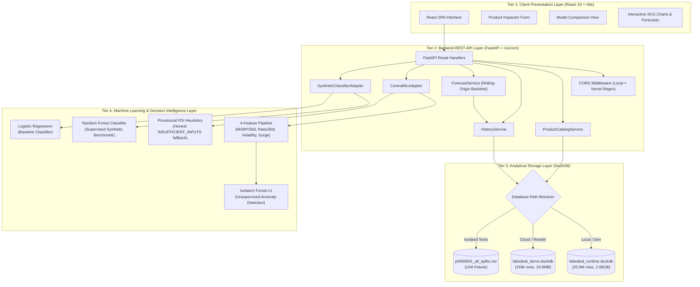

# FakeDeal Buster — System Architecture & Technical Specification

> **Document Status:** OFFICIAL PRODUCTION SYSTEM ARCHITECTURE SPECIFICATION  
> **Project:** FakeDeal Buster — Sale-Day Artificial Discount & Price Scam Detector  
> **Authors:** Gaurav Das (Lead), Rahul Amin (Backend), Lakhyajyoti Phukon (Data), Saniya Begum (Frontend), Myusha Chakma (QA)  
> **Institution:** Scholar Institute of Technology and Management (SITM), Guwahati

---

## 1. System Architecture Overview

**FakeDeal Buster** employs a modular, 4-tier decoupled architecture designed for sub-second e-commerce price anomaly detection, time-series historical trend analysis, and supervised machine learning model benchmarking.



---

## 2. Tier Details & Component Specifications

### 2.1 Tier 1: Client Presentation Layer
- **Core Technology:** React 19.3.1, Vite 8.3.6, Vanilla CSS modules, SVG data visualizers.
- **Components:**
  - **Product Inspector (`ProductInspector.jsx`):** Enables users to search products with autocompletion across 5 marketplaces, select observation dates, or enter custom product listings.
  - **Verdict Card (`AssessmentVerdict.jsx`):** Displays the standardized 3-state detection verdict:
    1. `Potential Suspicious Discount Pattern` (amber warning)
    2. `No Suspicious Pattern Detected` (green checkmark)
    3. `Insufficient Evidence` (neutral informational alert)
  - **Interactive Chart (`PriceHistoryChart.jsx`):** Pure SVG time-series visualizer showing daily transaction prices, 30-day moving average, reference MSRP, and cross-platform price comparisons.
  - **Forecast Visualizer (`ForecastCard.jsx`):** Displays conditional 14-day projected pricing curves with confidence intervals and chronological backtest error metrics (RMSE, MAE).
  - **Model Comparison View (`ModelComparisonView.jsx`):** Interactive benchmarking tab displaying side-by-side performance metrics (Precision, Recall, F1, ROC-AUC, PR-AUC, Gini, FPR) and confusion matrices between Random Forest and Logistic Regression.

### 2.2 Tier 2: Backend REST API Layer
- **Core Technology:** Python 3.12, FastAPI 0.115+, Pydantic v2.7+, Uvicorn ASGI server.
- **Security & Networking:**
  - **CORS Middleware:** Dynamic origin resolution supporting localhost ports (5173, 3000, 4173) and production Vercel frontend domains via regex pattern `https://.*\.vercel\.app`.
  - **Domain Exception Handling:** Translates application exceptions into RFC-compliant structured JSON errors:
    - HTTP 404: `PRODUCT_NOT_FOUND`
    - HTTP 409: `HISTORY_CONFLICT`
    - HTTP 422: `VALIDATION_ERROR` / `INVALID_PRODUCT_URL`
    - HTTP 503: `ML_SERVICE_UNAVAILABLE`
- **Primary Service Modules:**
  - `ProductCatalogService`: Fast catalogue search, normalization, and Amazon ASIN lookup.
  - `HistoryService`: Sub-millisecond historical price point retrieval, rolling summaries, and cross-platform comparisons with strict `as_of` temporal cutoffs.
  - `ForecastService`: Evaluates 5 rolling backtest origins (70 backtest points) over 180 consecutive daily observations before projecting 14 days forward.
  - `CentralMLAdapter`: Lazy-loads the verified `isolation_forest_v1` artifact bundle with SHA-256 validation.

### 2.3 Tier 3: Analytical Storage Layer
- **Core Technology:** DuckDB 2.0.0 columnar analytical embedded engine.
- **Dynamic Store Resolution:**
  1. `FAKEDEAL_DATABASE_PATH` environment variable (if explicitly configured).
  2. Full production store: `artifacts/derived/fakedeal_runtime.duckdb` (2.08 GB, 25,606,940 observations, 9,980 products).
  3. Lightweight demonstration store: `artifacts/derived/fakedeal_demo.duckdb` (20.76 MB, 246,010 observations, 98 products across all 7 categories and 5 platforms).
  4. Unit test CSV fixture: `artifacts/rahul_dataset_handoff/p0000001_all_splits.csv`.
- **Indexing Strategy:**
  - `CREATE INDEX observations_lookup_idx ON observations(product_id, platform, timestamp)`
  - `CREATE INDEX products_name_idx ON products(title)`
  - `CREATE INDEX product_platform_lookup_idx ON product_platforms(product_id, platform)`

### 2.4 Tier 4: Machine Learning & Decision Intelligence Layer

#### A. Production Unsupervised Anomaly Detection (Isolation Forest)
- **Model:** Scikit-learn `IsolationForest` (`n_estimators=100`, `contamination=0.05`, `random_state=42`).
- **Feature Engineering Pipeline:**
  1. `msrp_to_30d_avg`: Ratio of reference MSRP to 30-day trailing mean price ($\frac{\text{original\_price}}{\mu_{30}}$). Detects artificial list price inflation.
  2. `ratio_to_30d_avg`: Ratio of current transaction price to 30-day trailing mean ($\frac{\text{price}}{\mu_{30}}$). Detects abnormal price drops or sudden spikes.
  3. `price_volatility_30d`: Coefficient of variation ($\frac{\sigma_{30}}{\mu_{30}}$). Quantifies historical price volatility.
  4. `recent_7d_surge`: Ratio of 7-day trailing mean to 30-day trailing mean ($\frac{\mu_7}{\mu_{30}}$). Identifies pre-sale discount hikes.
- **Decision Contract:** Standardized 3-state output based on raw score sign ($s < 0.0 \implies \text{Anomaly}$) and data sufficiency check ($N \ge 14$).

#### B. Supervised Synthetic Scenario Benchmark
- **Dataset:** 40,000 synthetic discount scenarios with deterministic label assignment based on simulated artificial inflation patterns.
- **Data Splits:** 28,000 train (70%) / 6,000 validation (15%) / 6,000 held-out test (15%).
- **Pre-processing:** `StandardScaler` fitted strictly on train split to prevent data leakage.
- **Model Evaluation on Held-Out Test Split:**

| Metric | Logistic Regression (Baseline) | Random Forest (Selected Model) | Advantage |
|---|---|---|---|
| **Optimal Threshold** | 0.6800 | 0.4100 | Selected at FPR $\le$ 10% |
| **Precision** | 87.99% | **89.54%** | +1.55% higher precision |
| **Recall** | 66.70% | **73.60%** | **+6.90% higher recall** |
| **F1-Score** | 0.7588 | **0.8079** | **+0.0491 improvement** |
| **ROC-AUC** | 0.8891 | **0.9160** | **+0.0269 discrimination** |
| **PR-AUC (Avg Precision)** | 0.9019 | **0.9308** | **+0.0289 PR curve** |
| **Gini Coefficient** | 0.7782 | **0.8320** | **+0.0538 rank separation** |
| **False Positive Rate** | 9.10% | **8.60%** | Lower false alarm rate |

---

## 3. End-to-End Analysis Workflow & Data Flow

```
[User Form Submission]
         │
         ▼
[Input Validation (Pydantic)] ──(Invalid)──> [HTTP 422 VALIDATION_ERROR]
         │ (Valid)
         ▼
[Marketplace URL Resolution] ──(Mismatch)──> [HTTP 422 INVALID_PLATFORM]
         │ (Resolved / None)
         ▼
[Product Catalog Lookup] ──(Not Found)──> [HTTP 404 PRODUCT_NOT_FOUND]
         │ (Resolved)
         ▼
[DuckDB Historical Retrieval] (Observations < as_of)
         │
         ├─── Check Data Sufficiency (N >= 14 observations?)
         │        ├── No  ──> Assessment Verdict: INSUFFICIENT EVIDENCE
         │        └── Yes ──> Compute 4 Canonical Rolling Features
         │                         │
         │                         ▼
         │                    [Isolation Forest Inference]
         │                         │
         │                         ├── Score < 0.0 ──> Potential Suspicious Discount Pattern
         │                         └── Score >= 0.0 ─> No Suspicious Pattern Detected
         │
         ├─── Conditional Forecasting (N >= 180 consecutive daily observations?)
         │        ├── No  ──> Forecast: INSUFFICIENT_HISTORY
         │        └── Yes ──> 5-Window Rolling Backtest -> Select Best Baseline -> 14-day Curve
         │
         └─── Compile JSON Payload:
              { status, assessment_verdict, product, price_history, historical_summary, forecast, analysis }
```
