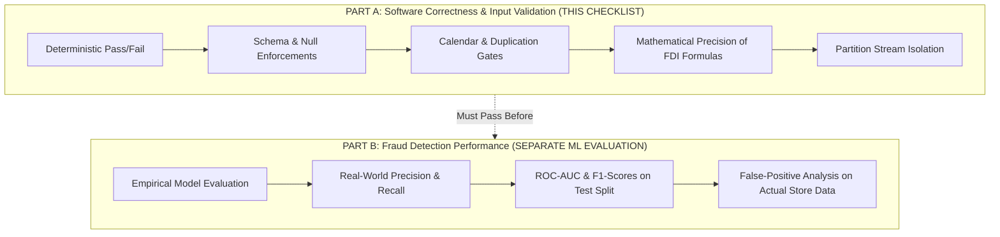

# FakeDeal Buster — Manual QA Testing Checklist

**Document ID:** QA-CHK-V1.0  
**Project:** FakeDeal Buster — Sale-Day Artificial Discount & Price Scam Detector  
**Institution:** Scholar Institute of Technology and Management (SITM), Guwahati  
**Role:** Data Preparation Analyst & QA Support  
**Target Fixture:** [fixtures/qa_scenarios.json](fixtures/qa_scenarios.json)  
**Status:** APPROVED FOR MANUAL & AUTOMATED QA TESTING  

---

## 1. Scope and Core Testing Principles

This manual checklist provides QA engineers, backend developers, and reviewers with a structured, step-by-step verification protocol for testing the FakeDeal Buster pipeline, data preprocessors, and API validation layers.

### Vital Separation of Concerns
Before conducting testing, all QA personnel must understand the distinction between the two testing tiers:

> [!CAUTION]
> **Testing Boundary & Provisional Scoring Rule:**  
> The tests in **Part A** verify that software functions correctly without crashing, violating types, corrupting math, or allowing invalid states.  
> 1. **Synthetic Scope Boundary:** Synthetic QA fixtures **do NOT** evaluate machine learning fraud detection accuracy, true-positive rates, or operational scam-detection performance (Part B).  
> 2. **Provisional Prototype Scoring:** All reported FDI values and risk tier assignments represent **illustrative prototype calculations using synthetic inputs** and provisional heuristic thresholds. In live inference, requests lacking required fields or sufficient historical depth ($N < 30$) return **`INSUFFICIENT_INPUTS`** rather than generating a risk tier.

---

## 2. Part A: Software Correctness & System Reliability Verification

### Section 1: Valid Historical Data and Baseline Aggregation

- [ ] **TC-01: Baseline 30-Day Aggregation Accuracy**
  - **Scenario Reference:** `QA-SCN-01` (Record count: 31)
  - **Test Objective:** Verify that an uninterrupted 30-day constant price sequence ($P = 100.00$) correctly computes 30-day baseline rolling metrics.
  - **Input Data:** `records` from `QA-SCN-01` (`P_TEST_001`, `amazon`, `2024-01-01` to `2024-01-30`).
  - **Expected Outcome:** 
    - `price_30d_avg == 100.00`
    - `price_30d_max == 100.00`
    - `price_volatility_30d == 0.0000`
  - **Pass Criteria:** Pipeline ingests all 30 days without dropping records; derived statistics match precomputed baseline within `1e-4`.

- [ ] **TC-02: Genuine Price Markdown Scoring**
  - **Scenario Reference:** `QA-SCN-03` (Record count: 31)
  - **Test Objective:** Verify that a legitimate price reduction ($P = 75.00$ vs baseline $100.00$) produces a low illustrative Fake Discount Index (FDI).
  - **Input Data:** Evaluation record from `QA-SCN-03` (`price: 75.00`, `original_price: 120.00`, `discount_pct: 37.50`).
  - **Expected Outcome:**
    - `real_discount_30d == 25.00`
    - `discount_inflation_gap == 12.50`
    - `fdi_score == 8.75` (illustrative prototype score)
    - `fdi_risk_tier == "Low Risk"` (provisional heuristic tier)
  - **Pass Criteria:** Software evaluates successfully; score equals `8.75`; status is `SUCCESS_EVALUATED`.

---

### Section 2: Cold-Start and Time-Series Continuity Gates

- [ ] **TC-03: Insufficient Historical Depth Rejection**
  - **Scenario Reference:** `QA-SCN-05` (Record count: 5)
  - **Test Objective:** Verify that cold-start products with fewer than 30 (or minimum 14) observations are not scored prematurely.
  - **Input Data:** 5 records from `QA-SCN-05` (`P_TEST_005`, `walmart`, `2024-01-01` to `2024-01-05`).
  - **Expected Outcome:**
    - System rejects FDI score generation.
    - Status code / flag: `INSUFFICIENT_INPUTS` (or `NEEDS_MORE_DATA`).
    - Error message: `INSUFFICIENT_HISTORY_N_LESS_THAN_30` (or `...LESS_THAN_14`).
    - FDI score is `null` (not 0.00 or crash).
  - **Pass Criteria:** No unhandled division-by-zero or NaN in response payload.

- [ ] **TC-04: Discontinuous Calendar Gap Detection**
  - **Scenario Reference:** `QA-SCN-06` (Record count: 15)
  - **Test Objective:** Verify that time series with missing calendar dates ($> 1$ day step) trigger discontinuity alerts rather than naively treating rows as consecutive.
  - **Input Data:** 15 records from `QA-SCN-06` with 14-day gap (`2024-01-11` to `2024-01-24` missing).
  - **Expected Outcome:**
    - Time-series preprocessor detects $\Delta t = 15 \text{ days} > 1 \text{ day}$.
    - Status code: `INSUFFICIENT_INPUTS` / `NEEDS_MORE_DATA`.
    - Error code: `TIME_SERIES_DISCONTINUITY_CALENDAR_GAP`.
  - **Pass Criteria:** Software halts scoring on staled series and flags discontinuity.

---

### Section 3: Composite Primary Key Integrity and Deduplication

- [ ] **TC-05: Composite Key Collision Rejection**
  - **Scenario Reference:** `QA-SCN-07` (Record count: 31)
  - **Test Objective:** Verify that duplicate observations sharing the composite entity key `(product_id, platform, timestamp)` are rejected during batch ingestion.
  - **Input Data:** 31 records from `QA-SCN-07` containing duplicate Day 30 timestamps (`2024-01-30T00:00:00`) with conflicting prices ($45.00 vs $55.00).
  - **Expected Outcome:**
    - Ingestion layer rejects duplicate records or fails batch validation.
    - Status code: `INVALID_INPUT_DUPLICATE`.
    - Error code: `PRIMARY_KEY_COLLISION_DUPLICATE_TIMESTAMP`.
  - **Pass Criteria:** System does not silently overwrite or average colliding records without an explicit duplicate resolution policy.

---

### Section 4: Numerical Range and Schema Boundary Enforcement

- [ ] **TC-06: Non-Positive and Negative Price Validation (VR-01, VR-02)**
  - **Scenario Reference:** `QA-SCN-08` (`SCN08_REC_01`, `SCN08_REC_02`)
  - **Test Objective:** Verify immediate rejection of zero and negative selling prices.
  - **Input Records:**
    - `SCN08_REC_01`: `price: 0.00`, `original_price: 50.00`
    - `SCN08_REC_02`: `price: -15.00`, `original_price: 50.00`
  - **Expected Outcome:** `VALIDATION_ERROR` with `INVALID_PRICE_ZERO` and `INVALID_PRICE_NEGATIVE`.
  - **Pass Criteria:** Records rejected at API/schema layer prior to any feature calculation.

- [ ] **TC-07: Invalid Reference MSRP and Inverted Pricing (VR-03, VR-04)**
  - **Scenario Reference:** `QA-SCN-08` (`SCN08_REC_03`, `SCN08_REC_04`)
  - **Test Objective:** Verify rejection of non-positive MSRP and prices that exceed stated MSRP ($P > P_{\text{orig}}$).
  - **Input Records:**
    - `SCN08_REC_03`: `price: 50.00`, `original_price: 0.00`
    - `SCN08_REC_04`: `price: 120.00`, `original_price: 100.00`
  - **Expected Outcome:** `VALIDATION_ERROR` with `INVALID_MSRP_ZERO` and `PRICE_EXCEEDS_MSRP`.
  - **Pass Criteria:** Both inverted and zero-MSRP records rejected with descriptive error codes.

- [ ] **TC-08: Advertised Discount Boundary Enforcement (VR-05, VR-06, VR-07, VR-08)**
  - **Scenario Reference:** `QA-SCN-08` (`SCN08_REC_05`, `SCN08_REC_06`, `SCN08_REC_07`)
  - **Test Objective:** Verify enforcement of dataset schema cap (90%), mathematical ceiling (100%), and formula arithmetic.
  - **Input Records:**
    - `SCN08_REC_05`: `price: 5.00`, `original_price: 100.00`, `discount_pct: 95.00%` (Exceeds dataset 90% cap; math valid)
    - `SCN08_REC_06`: `price: 10.00`, `original_price: 100.00`, `discount_pct: 110.00%` (Exceeds 100% ceiling)
    - `SCN08_REC_07`: `price: 80.00`, `original_price: 100.00`, `discount_pct: 50.00%` (Arithmetic mismatch: actual is 20%)
  - **Expected Outcome:**
    - `SCN08_REC_05`: `DISCOUNT_EXCEEDS_DATASET_CAP_90`
    - `SCN08_REC_06`: `DISCOUNT_EXCEEDS_MATHEMATICAL_CEILING_100`
    - `SCN08_REC_07`: `DISCOUNT_FORMULA_MISMATCH`
  - **Pass Criteria:** Specific validation errors raised for each distinct boundary condition.

---

### Section 5: Mandatory Schema Field Null Handling

- [ ] **TC-09: Missing Mandatory Attributes Isolation**
  - **Scenario Reference:** `QA-SCN-09` (`SCN09_REC_01`, `SCN09_REC_02`, `SCN09_REC_03`)
  - **Test Objective:** Verify graceful rejection of payloads with null mandatory attributes.
  - **Input Records:**
    - `SCN09_REC_01`: `price = null`
    - `SCN09_REC_02`: `original_price = null`
    - `SCN09_REC_03`: `timestamp = null`
  - **Expected Outcome:** API returns HTTP 422 / `INSUFFICIENT_INPUTS` / `VALIDATION_ERROR` with specific field identified (`MISSING_MANDATORY_FIELD_<NAME>`).
  - **Pass Criteria:** Zero uncaught `TypeError` or `AttributeError` exceptions in server log.

---

### Section 6: Multi-Stream Product-Platform Partition Isolation

- [ ] **TC-10: Multi-Platform and Cross-Product Independence**
  - **Scenario Reference:** `QA-SCN-10` (Record count: 124, 4 streams)
  - **Test Objective:** Verify that stream aggregation groups strictly by `(product_id, platform)` without cross-stream contamination.
  - **Input Data:** Full 124 records of `QA-SCN-10` fed in interleaved chronological order.
  - **Verification Assertions:**
    - Stream 1 `(P_TEST_010A, amazon)`: $\mu_{30} = 100.00, \text{FDI} = 8.75$ (Low Risk)
    - Stream 2 `(P_TEST_010A, walmart)`: $\mu_{30} = 200.00, \text{FDI} = 65.17$ (High Risk)
    - Stream 3 `(P_TEST_010B, amazon)`: $\mu_{30} = 10.00, \text{FDI} = 15.00$ (Low Risk)
    - Stream 4 `(P_TEST_010B, walmart)`: $\mu_{30} = 500.00, \text{FDI} = 15.00$ (Low Risk)
  - **Contamination Failure Check:**
    - If `(P_TEST_010A, amazon)` leaks into `(P_TEST_010A, walmart)`, Stream 1 mean will not equal $100.00$.
    - If Amazon and Walmart records collide for the same product, FDI scores will diverge from reference values.
  - **Pass Criteria:** All 4 streams compute identical statistics to their independent baselines.

---

### Section 7: Unusual Pricing and Scam Detection Calculations

- [ ] **TC-11: Pre-Sale Price Hike / Artificial Discount Detection**
  - **Scenario Reference:** `QA-SCN-02` (Record count: 31)
  - **Test Objective:** Verify detection of pre-sale price increase paired with inflated discount claim.
  - **Input Data:** Evaluation record from `QA-SCN-02` ($P = 115.00$, $P_{\text{orig}} = 150.00$, $\mu_{30} = 100.00$, $P_{\text{max},7} = 115.00$).
  - **Expected Calculations:**
    - `ratio_to_30d_avg == 1.1500`
    - `real_discount_30d == 0.00`
    - `discount_inflation_gap == 23.33`
    - `fdi_score == 70.83` (illustrative prototype score)
    - `fdi_risk_tier == "High Risk"` (provisional heuristic tier)
  - **Pass Criteria:** Correct high-risk classification reflecting price hike.

- [ ] **TC-12: Reference MSRP Inflation Detection**
  - **Scenario Reference:** `QA-SCN-04` (Record count: 31)
  - **Test Objective:** Verify detection of fabricated discount created solely by inflating original MSRP anchor ($100 \to 250$).
  - **Input Data:** Evaluation record from `QA-SCN-04` ($P = 100.00$, $P_{\text{orig}} = 250.00$, $P_{\text{max},52} = 100.00$).
  - **Expected Calculations:**
    - `msrp_inflation_ratio == 2.5000`
    - `fdi_sub_msrp_inflation == 100.00` (saturated)
    - `fdi_score == 70.00` (illustrative prototype score)
    - `fdi_risk_tier == "High Risk"` (provisional heuristic tier)
  - **Pass Criteria:** Correct identification of MSRP inflation anchor scam.

---

## 3. Test Execution Log Sheet Template

| Test Case ID | Scenario ID | Target Feature / Behavior | Actual Output | Pass/Fail | Tester Signature | Date |
|---|---|---|---|:---:|---|---|
| **TC-01** | QA-SCN-01 | Baseline 30d Average = 100.00 | | | | |
| **TC-02** | QA-SCN-03 | Legitimate Markdown FDI = 8.75 | | | | |
| **TC-03** | QA-SCN-05 | N=5 Rejection (`INSUFFICIENT_INPUTS`) | | | | |
| **TC-04** | QA-SCN-06 | 14-Day Gap (`INSUFFICIENT_INPUTS`) | | | | |
| **TC-05** | QA-SCN-07 | Duplicate Key (`INVALID_INPUT_DUPLICATE`) | | | | |
| **TC-06** | QA-SCN-08 | Price <= 0 (`VALIDATION_ERROR`) | | | | |
| **TC-07** | QA-SCN-08 | MSRP <= 0 or P > MSRP (`VALIDATION_ERROR`) | | | | |
| **TC-08** | QA-SCN-08 | Discount Cap 90%/100% (`VALIDATION_ERROR`) | | | | |
| **TC-09** | QA-SCN-09 | Missing Mandatory Fields (`VALIDATION_ERROR`)| | | | |
| **TC-10** | QA-SCN-10 | 4 Stream Partition Isolation | | | | |
| **TC-11** | QA-SCN-02 | Price Hike Scam FDI = 70.83 | | | | |
| **TC-12** | QA-SCN-04 | MSRP Inflation Scam FDI = 70.00 | | | | |

---

## 4. Reviewer Approval and Sign-Off

- **Prepared By:** Lakhyajyoti Phukan (Data Preparation Analyst & QA Support)  
- **Verified Deliverable:** `tests/fixtures/qa_scenarios.json`  
- **Software Pass Threshold:** 100% (12/12 test cases in Part A must pass before backend deployment).  
- **Next Stage:** Deliver fixture package to Rahul Amin (Backend Developer) and Gaurav Das (ML Developer).
